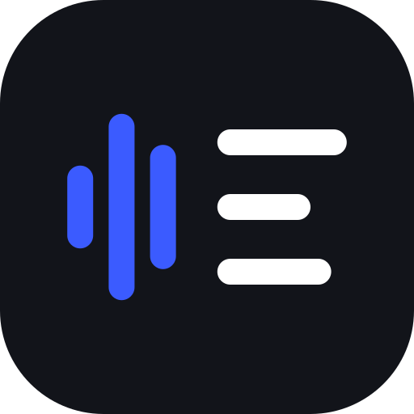

<p align="center"></p>

# Voxly

Open-source dictation for coding. Speak, and the text lands in your editor, with your technical vocabulary spelled correctly. Transcription runs either **locally** (whisper.cpp, no account, no key, audio never leaves your machine) or through OpenAI Whisper with **your own API key**.

Written in Rust with [Tauri 2](https://tauri.app): one codebase for macOS, Linux, Windows, iOS and Android.

## Features

- Local backend: pick a model (Base / Small / Large v3 Turbo) and download it in the app
- Or cloud backend with your own OpenAI API key (stored locally in `settings.json`, mode 0600 on Unix)
- Vocabulary: terms are sent as a Whisper prompt, and "sounds like" phrases are rewritten afterwards (`use state` → `useState`)
- Global hotkeys (desktop): hold to record, toggle recording, paste last recording
- Auto-paste into the focused app
- Models: `whisper-1`, `gpt-4o-transcribe`, `gpt-4o-mini-transcribe`

## Layout

- `crates/core`: settings, vocabulary, microphone capture (cpal), OpenAI client. No UI dependencies.
- `src-tauri`: the Tauri app (hotkeys, clipboard, paste, commands)
- `ui`: plain HTML/JS frontend, no bundler

## Run

Building needs `cmake` and a C++ compiler (for whisper.cpp). Local transcription is desktop-only for now.

```sh
cargo install tauri-cli --version "^2"
cargo tauri dev          # desktop
cargo tauri build        # installers
cargo test --workspace
```

Mobile (needs Xcode / Android Studio + NDK):

```sh
cargo tauri ios init && cargo tauri ios dev
cargo tauri android init && cargo tauri android dev
```

## GPU acceleration

Local transcription runs on the GPU by default (setting "Use the GPU when available"), and falls back to the CPU if none is usable.

| Platform | Backend | Build |
| --- | --- | --- |
| macOS, Apple Silicon | Metal | automatic |
| Windows / Linux, AMD + NVIDIA + Intel | Vulkan | `--features vulkan` (needs the Vulkan SDK: headers and `glslc`) |
| Windows / Linux, NVIDIA only | CUDA | `--features cuda` (needs the CUDA toolkit) |
| Linux, AMD only | ROCm/HIP | `AMDGPU_TARGETS=gfx1030 cargo tauri build --features hip` (your card's id: `rocminfo`) |

The release installers for Windows and Linux are built with Vulkan, so they need a Vulkan driver, which ships with the normal AMD/NVIDIA/Intel GPU drivers.

## Platform notes

- **macOS**: grant Microphone and Accessibility (needed to simulate Cmd+V) permission.
- **Linux (X11)**: global hotkeys and simulated paste work out of the box.
- **Linux (Wayland, e.g. Hyprland)**: the in-app hotkeys work here too. Wayland has no global key grabs, so Voxly reads the keyboards from `/dev/input` instead (keys are observed, not grabbed, so they still reach the focused app). Your user must be in the `input` group: `sudo usermod -aG input $USER`, then log in again. Clipboard uses `wl-copy` and auto-paste uses `wtype` (or `ydotool`), so install `wl-clipboard` and `wtype`; terminals get Ctrl+Shift+V (detected via `hyprctl`). Optionally, `voxly start|stop|toggle|paste-last|show` controls the running app from compositor binds. Wayland compositors ignore window positions, so to keep the overlay pill from stealing focus on Hyprland add `windowrule = no_focus on, match:title ^Voxly overlay$`.
- **iOS / Android**: no global hotkeys or system-wide paste from a regular app. You record in the app and the result goes to the clipboard. A system keyboard (IME) is the route to true system-wide dictation and is not built yet.

## License

MIT

## Releases

Installers for macOS (Apple Silicon and Intel), Windows and Linux are built by GitHub Actions. Push a tag to create a draft release:

```sh
git tag v0.2.0 && git push origin v0.2.0
```

macOS builds are signed and notarized when these repository secrets are set: `APPLE_CERTIFICATE` (base64 of the Developer ID Application `.p12`), `APPLE_CERTIFICATE_PASSWORD`, `APPLE_SIGNING_IDENTITY`, `APPLE_ID`, `APPLE_PASSWORD` (app-specific password) and `APPLE_TEAM_ID`. Without them the macOS build is unsigned. Windows builds are not signed yet.
